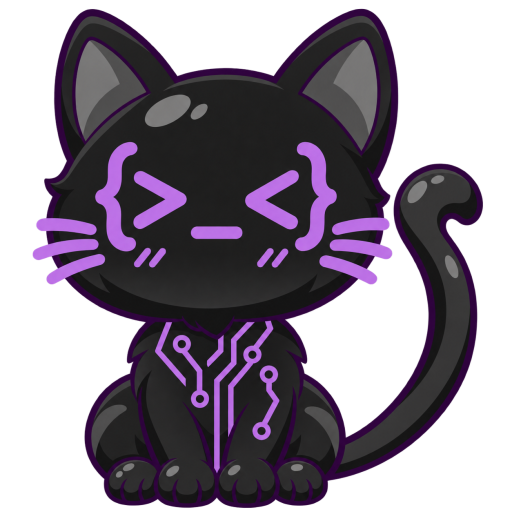

<div align="center">


<br><br>

# Artisan Brew Co. (ABC)

**Contemporary Coffee Studio · Atomic POS & Inventory · Animated 80mm Thermal Printer · Brevo HTTPS Email Platform**

*Built by **RootKitCats** for IT0049 Web System Technologies*

<p>
  <a href="https://artisanbrew.kcykae.dev"></a>
  
  
  
  
</p>

<p>
  <a href="#-public-coffee-studio">Coffee Studio</a> •
  <a href="#-pos-inventory--thermal-printer">POS & Thermal Printer</a> •
  <a href="#-brevo-https-email-platform">Brevo Email System</a> •
  <a href="#-role-permission-matrix">Permissions</a> •
  <a href="#-local-setup">Local Setup</a> •
  <a href="#-team-rootkitcats">RootKitCats</a>
</p>

</div>

---

## ☕ Public Coffee Studio

| Route | Experience |
| --- | --- |
| [`/`](https://artisanbrew.kcykae.dev) | Warm-black studio landing page (`rgb(22, 20, 18)`), animated hero cup & steam entrance, signature brews, studio photography, contact concierge (`POST /contact`), and double opt-in newsletter (`POST /newsletter/subscribe`). |
| [`/menu`](https://artisanbrew.kcykae.dev/menu) | Live public menu synced directly with active, non-archived catalog products, drink variants, and add-ons in PHP (`₱`). |
| [`/about`](https://artisanbrew.kcykae.dev/about) | **RootKitCats** developer showcase with animated team emblem, engineering roles, and GitHub profiles. |

---

## 🧾 POS, Inventory & Thermal Printer

- **Multi-Item Counter POS (`/pos`) & Record Sale (`/sales/record`)**
  - Variants, paid add-ons, quick line notes (*Less Ice*, *No Ice*, *Less Sugar*, *Extra Hot*), walk-in **Cup Name**, and **Dine-in / Take-out** service types.
  - **Cash**, **Card**, and **GCash** payments with reference tracking, plus **Percent (`%`)**, **Fixed (`₱`)**, and **Gift Card** discounts.
- **Animated 80mm Thermal Receipt Printer**
  - Charcoal printer chassis with recessed exit slot, foreground cutter lip, stepper-paced upward paper feed, serrated top/bottom edges, cutter sweep & release settle, `80mm` / `A4` toggle, `prefers-reduced-motion` support, and clean `@media print` receipt-only output.
- **Manager-Authorized Voiding**
  - Admins void directly; cashiers void their own orders through a manager-credential override modal, atomically restoring stock and gift card balances.
- **Atomic Concurrency & Monetary Precision**
  - Integer-centavo math (`App\Support\Money`), server-side recalculation in `App\Services\CheckoutService`, `DB::transaction(..., 3)` with `lockForUpdate()` in ascending `product_id` order, optimistic `stock_version` checks, and `(sold_by, checkout_token)` idempotency.

---

## ✉️ Brevo HTTPS Email Platform

All transactional and marketing emails run exclusively through **Brevo's REST/HTTPS v3 API** (no SMTP or `mail()`), backed by a durable `email_deliveries` outbox, prioritized queues (`emails-priority`, `emails`, `emails-webhooks`, `emails-marketing`), and signed webhooks (`/admin/email` · [docs/email-system.md](docs/email-system.md)).

| # | Capability | Highlights |
| --- | --- | --- |
| **1** | **Customer Digital Receipts** | Optional checkout email, confirmation-gated resend, and signed public receipt link (`/receipts/signed/{order}`). |
| **2** | **Staff Password Recovery** | Throttled reset links via `BrevoApiChannel` on `emails-priority`; revokes active sessions on reset. |
| **3** | **Staff Invitations** | 48-hour hashed invite tokens (`/invitations/{token}`), resend/revoke controls, and reset blocking until activation. |
| **4** | **Low-Stock & Sold-Out Alerts** | Post-commit transition alerts (or hourly digest) with restock re-arming and archived-item exclusion. |
| **5** | **Daily Sales Summaries** | Automated `Asia/Manila` closing report matching dashboard KPIs with CSV breakdown attachment. |
| **6** | **Account-Security Alerts** | Notifications on password changes/resets, role changes, deactivation, and pending email verification. |
| **7** | **Contact Enquiries** | Honeypot- and rate-limit-protected public form storing records before queuing `Reply-To` notifications. |
| **8** | **Newsletter & Campaigns** | Double opt-in confirmation, one-click unsubscribe, bidirectional Brevo suppression sync, and `BREVO_LIVE_SEND_ENABLED` guard. |

---

## 🔐 Role Permission Matrix

| Capability | Admin | Cashier |
| --- | :---: | :---: |
| Executive Dashboard & Chart.js Reports (`/dashboard`) | ✅ | ❌ `403` |
| Multi-Item POS (`/pos`) & Record Sale (`/sales/record`) | ✅ | ✅ |
| Sales History, Receipts & Email Resend (`/sales`, `/orders/{id}/receipt`) | All orders | Own orders only |
| Void Order (`/orders/{id}/void`) | Direct | Own orders w/ Manager override |
| Products, Stock, Variants, Categories, Add-ons (`/products`, `/menu-config`) | Full CRUD / Archive | Read in POS only |
| Customers (`/customers`) | Full CRUD | View / Create / Update |
| Staff, Invitations & Email Center (`/staff`, `/admin/email`) | Full access | ❌ `403` |
| Profile, Email Verification, Avatar & Password (`/profile`) | ✅ | ✅ *(role immutable)* |

---

## 🚀 Local Setup

1. **Install dependencies & build frontend assets:**
   ```bash
   composer install
   npm install && npm run build
   ```
2. **Configure environment (`.env`):**
   ```bash
   cp .env.example .env
   php artisan key:generate
   ```
   Defaults: `APP_TIMEZONE=UTC`, `POS_DISPLAY_TIMEZONE=Asia/Manila`, `DB_CONNECTION=mariadb`, `DB_DATABASE=artisan_brew_co`, `QUEUE_CONNECTION=database`, `BREVO_LIVE_SEND_ENABLED=false` (safe simulated mode locally).
3. **Create databases & run migrations:**
   ```sql
   CREATE DATABASE IF NOT EXISTS artisan_brew_co CHARACTER SET utf8mb4 COLLATE utf8mb4_unicode_ci;
   CREATE DATABASE IF NOT EXISTS artisan_brew_co_test CHARACTER SET utf8mb4 COLLATE utf8mb4_unicode_ci;
   ```
   ```bash
   php artisan migrate
   ```
4. **Create an admin or seed local demo data:**
   ```bash
   php artisan abc:create-admin
   ```

<details>
<summary><strong>Local Demo Seeder & Credentials (opt-in for local testing only)</strong></summary>

```bash
php artisan abc:seed-demo
```

| Role | Username | Password | Landing Page |
| --- | --- | --- | --- |
| **Admin** | `admin` | `Admin@1234` | `/dashboard` |
| **Admin** | `manager` | `Manager@1234` | `/dashboard` |
| **Cashier** | `cashier` | `Cashier@1234` | `/pos` |
| **Cashier** | `barista` | `Barista@1234` | `/pos` |

</details>

5. **Run locally:**
   ```bash
   php artisan serve --host=127.0.0.1 --port=8000
   ```

---

## 📚 Documentation

- [docs/email-system.md](docs/email-system.md) — Brevo HTTPS v3 API architecture, DNS, webhooks, and worker/scheduler setup
- [docs/deployment.md](docs/deployment.md) — Production Laravel hosting guide
- [docs/database-design.md](docs/database-design.md) — ER diagram, schema foundation, deletion policy, timezone & money policies
- [docs/requirements-checklist.md](docs/requirements-checklist.md) — Source-to-implementation mapping & IT0049 rubric checklist
- [docs/test-results.md](docs/test-results.md) — Automated tests & concurrency verification notes

---

## 👾 Team RootKitCats

<div align="center">
  
</div>

| Member | GitHub | Role |
| --- | --- | --- |
| **Kyl Aldric Valencia** | [@kcyKael](https://github.com/kcyKael) | Project Lead, Full-Stack Developer, and System Architect |
| **Emran Ryan Maina** | [@ramenagiii](https://github.com/ramenagiii) | Backend Developer and Database Developer |
| **Jerahmeel Romero** | [@jdgr1](https://github.com/jdgr1) | Frontend and Product Module Developer, UI/UX Lead Developer |
| **Erin Gabrielle Maliñana** | [@O3r1n-Br13ll3](https://github.com/O3r1n-Br13ll3) | Quality Assurance and Integration Developer, UI/UX Assistant Developer |
