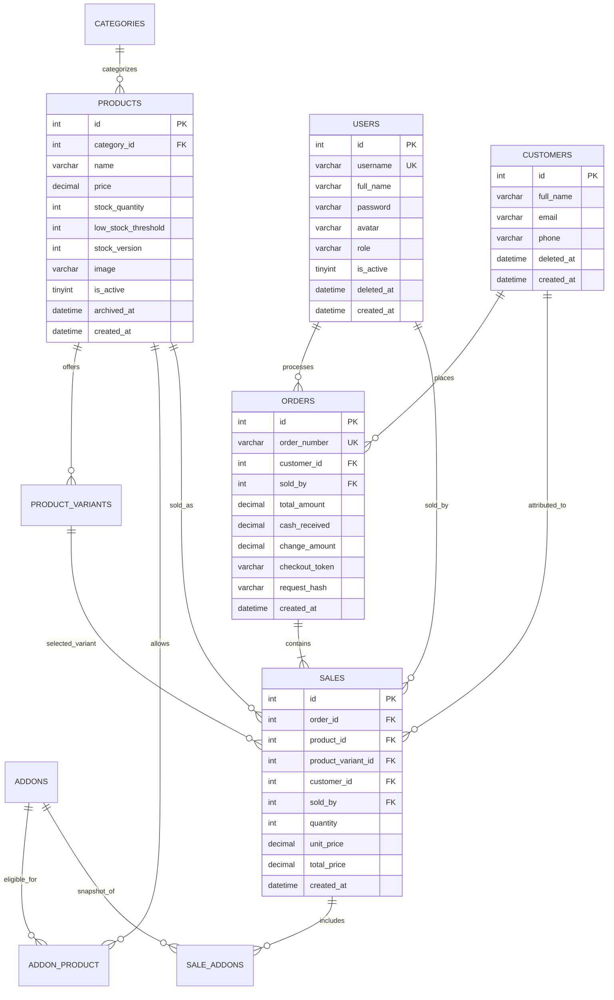

# Database Design — Artisan Brew Co. (ABC)

Engine: **InnoDB** · Charset: **`utf8mb4`** · Collation: **`utf8mb4_unicode_ci`** · Tested on **MariaDB 10.4.32**

## 1. Preserved IT0049 SQL Foundation

The four required assignment tables (`products`, `customers`, `users`, `sales`) retain their exact table names, required columns, compatible **signed `INT` primary/foreign keys** (`int(11)`), `DECIMAL(10,2)` monetary columns, and foreign-key constraints:

| Required Table | Preserved Required Columns | Preserved Foreign Keys |
| --- | --- | --- |
| `products` | `id`, `name`, `price`, `stock_quantity`, `image`, `created_at` | — |
| `customers` | `id`, `full_name`, `email`, `phone`, `created_at` | — |
| `users` | `id`, `username` (UNIQUE), `full_name`, `password`, `avatar`, `created_at` | — |
| `sales` | `id`, `product_id`, `customer_id` (nullable), `sold_by`, `quantity`, `total_price`, `created_at` | `product_id -> products(id)`, `customer_id -> customers(id)`, `sold_by -> users(id)` |

---

## 2. Additive Extensions (Implemented for Approved Features)

These tables and columns extend the foundation without altering or bypassing the four required tables:

- **`users` (additive):** `role` (`'admin'|'cashier'`, CHECK constraint), `is_active`, `remember_token`, `deleted_at`, `updated_at`.
- **`categories`:** `id`, `name` (UNIQUE), `slug` (UNIQUE), `sort_order`, `is_drink`, `is_active`, `created_at`, `updated_at`.
- **`products` (additive):** `category_id -> categories(id)` (`ON DELETE SET NULL`), `sku` (UNIQUE), `description`, `low_stock_threshold`, `is_active`, `stock_version` (optimistic edit guard), `archived_at`, `updated_at`, plus `CHECK` constraints for nonnegative `price`, `stock_quantity`, and `low_stock_threshold`.
- **`product_variants`:** `id`, `product_id -> products(id)` (`ON DELETE CASCADE`), `size_label`, `temperature` (`'hot'|'iced'`), `price_adjustment` (`>= 0`), `is_active`, `sort_order`, unique `(product_id, size_label, temperature)`.
- **`addons` & `addon_product`:** Paid add-ons (`price >= 0`) and explicit per-product eligibility pivot.
- **`customers` (additive):** `notes`, `deleted_at`, `updated_at`.
- **`orders`:** Groups single-item (`record_sale`) and multi-item (`pos`) checkouts under a unique `order_number` (`ABC-YYYYMMDD-XXXXXX`), storing `customer_id`, `sold_by`, `customer_name_snapshot`, `staff_name_snapshot`, `subtotal_amount`, `total_amount`, `cash_received`, `change_amount`, `checkout_token`, and `request_hash` with `UNIQUE (sold_by, checkout_token)` for idempotent checkout retries.
- **`sales` (additive):** Retains its role as the authoritative **sale-line table** (no competing `order_items` table), adding `order_id -> orders(id)`, `product_variant_id -> product_variants(id)` (`ON DELETE SET NULL`), and immutable receipt snapshots (`product_name_snapshot`, `variant_label_snapshot`, `base_price_snapshot`, `variant_adjustment_snapshot`, `addons_total_snapshot`, `unit_price`, `updated_at`).
- **`sale_addons`:** Snapshots selected add-ons per `sale_id` (`addon_name_snapshot`, `addon_price_snapshot`).
- **`sessions`, `cache`, `cache_locks`:** Laravel database session/cache driver tables (`sessions.user_id` uses signed `INT`).

---

## 3. Entity-Relationship Diagram

---

## 4. Deletion, Archiving & Snapshot Policies

- **Products:** Unreferenced products (`sales_count = 0`) are hard-deleted along with their prepared image file. Products referenced in `sales` are **archived** (`archived_at` set, `is_active = false`) and can be restored from the Products list.
- **Customers & Staff:** Unreferenced records (`orders_count = 0` and `sales_count = 0`) are hard-deleted. Referenced records use Laravel `SoftDeletes` (`deleted_at`) so they leave all active lookups, POS selectors, and login access while preserving `RESTRICT` foreign keys and authorized historical receipts (`withTrashed()` + stored snapshots). This design choice preserves full CRUD visibility alongside the assignment's foreign-key integrity.
- **Final Active Admin Guard:** `StaffController` blocks deleting, deactivating, or demoting the final active administrator account, and blocks an admin from deleting themselves.

---

## 5. Timezone & Money Policies

- **Storage vs. Display Timezone:** `APP_TIMEZONE=UTC` persists all timestamps consistently in UTC. `App\Support\BusinessTime` formats displayed dates in `Asia/Manila` (`POS_DISPLAY_TIMEZONE`) and converts Manila calendar date filters (`from`/`to`, `today`) into UTC `WHERE created_at BETWEEN ? AND ?` bounds.
- **Monetary Calculation:** `App\Support\Money` converts decimals to integer centavos before arithmetic and writes normalized 2-decimal strings into `DECIMAL(10,2)` columns.
